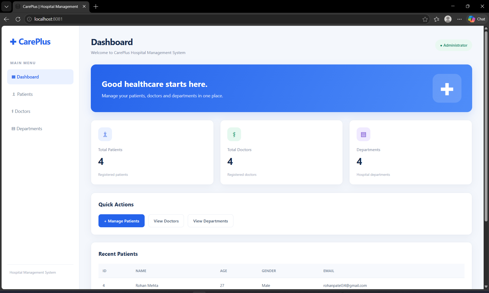

# CarePlus – Hospital Management System

CarePlus is a web-based Hospital Management System developed using Spring Boot, Java, MySQL, REST APIs, and SOAP Web Services. It provides a dashboard for managing hospital information through a simple user interface.

## Features

- Dashboard for hospital management
- Patient management with CRUD operations
- Doctor management
- Department management
- REST API integration
- SOAP Web Service for patient information
- Frontend built with HTML, CSS, and JavaScript
- MySQL database integration

## Technologies Used

- **Backend:** Java, Spring Boot
- **Database:** MySQL
- **APIs:** REST APIs, SOAP Web Services
- **Frontend:** HTML, CSS, JavaScript
- **Build Tool:** Maven
- **IDE:** Spring Tools for Eclipse (STS)
- **Testing:** Postman

## Project Structure

```text
hospital-management-system/
├── src/
│   └── main/
│       ├── java/
│       └── resources/
├── .gitignore
├── mvnw
├── mvnw.cmd
└── pom.xml
```

## Setup Instructions

1. Clone this repository:

   ```bash
   git clone https://github.com/hetviyas23-sudo/careplus-hospital-management-system.git
   ```

2. Open the project in Spring Tools for Eclipse or another compatible Java IDE.

3. Install the required Java version and ensure MySQL is running.

4. Create a MySQL database named `hospital_management`.

5. Configure your local database username, password, and connection settings in `src/main/resources/application.properties`. This file is intentionally excluded from the repository.

6. Run the Spring Boot application.

7. Open the dashboard in your browser at:

   `http://localhost:8081/`

## API and SOAP Testing

- REST API base URL: `http://localhost:8081/`
- SOAP endpoint: `http://localhost:8081/ws`
- SOAP WSDL: `http://localhost:8081/ws/patients.wsdl`

Use Postman to test the REST APIs and SOAP requests.

## Security Note

Database credentials and other secrets should be stored locally and must not be committed to the public repository.

## Author

Hetvi

---

*Developed as a hospital management project to practice Java, Spring Boot, database integration, REST APIs, and SOAP Web Services.*
